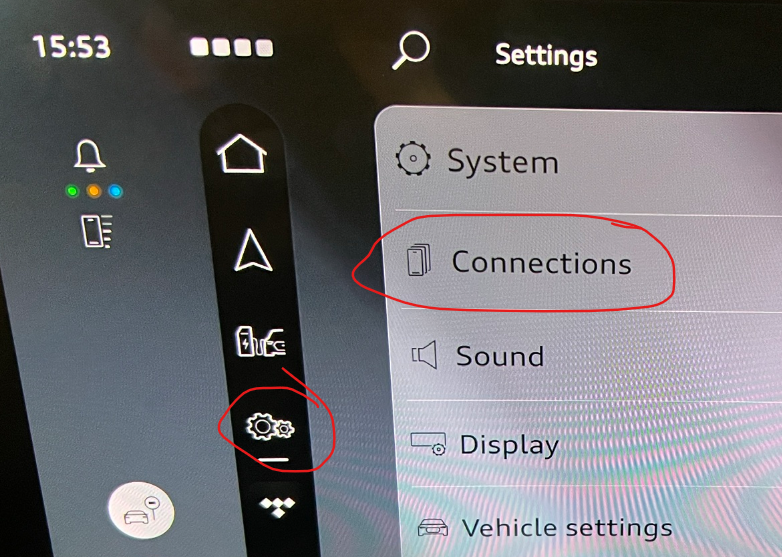
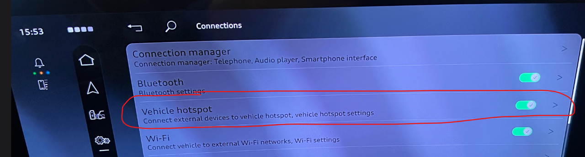
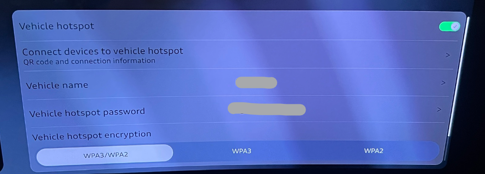
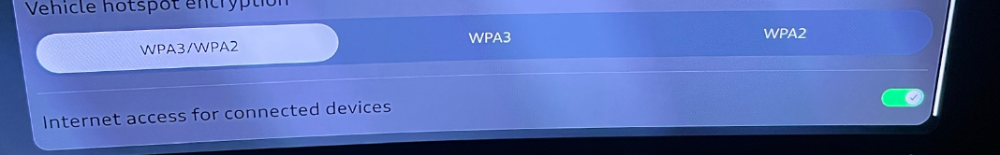
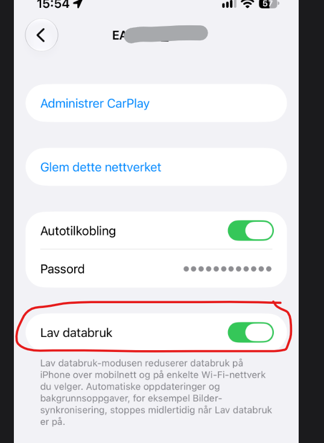
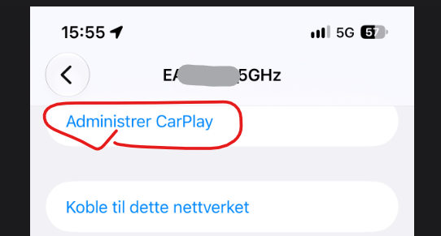

Du kan bruke bilen din som Internett tilkoplingspunkt. Det kreves at du har etablet en Audi Datavolum avtale.

Du finner valget i Innstillingsmenye og Forbindelser

Internettsonen kan du slå av og på ved å trykke i det røde feltet, eller direkte på knappen til høyre

Du kommer inn i detaljinnstillingene om du trykke på bilen helt til høyre i bildet over

Her kan du sette passord, gi sonen et navn og du kan til og med slå av og på Internettforbindelsen for sonen.

Og når du har koplet opp din mobil til dette nettverket, kan det være veldig lurt å velge 'Lav databruk' for denne forbindelsen, slik at app oppdateringer, backup, iCloud synkroniseringer osv ikke utføre på denne forbindelsen, som da du har kun 10 GB tilgjengelig pr måned.

Du bør jo også vurdere om du vil ha autotilkoling.

Siden bilen har ekstern mobilantenne, så er det sannsynlig at bilen bil ha bedre dekning enn din mobil i området med dårlig mobildekning, så da kan denne forbindelsen være nyttig å ha.

Det er også her du konfigurerer Trådløs Apple CarPlay om det er en iPhone du bruker.

