Gratulerer med ny bil !

Dette er det bildet du vil se første gangen du strater opp bilen din

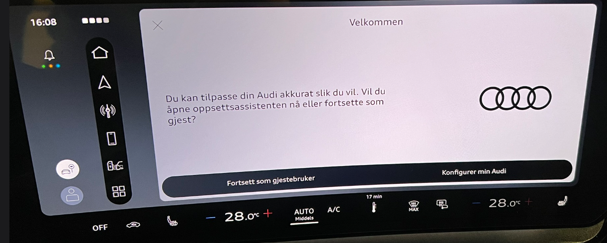

Og slik vil appen din se ut

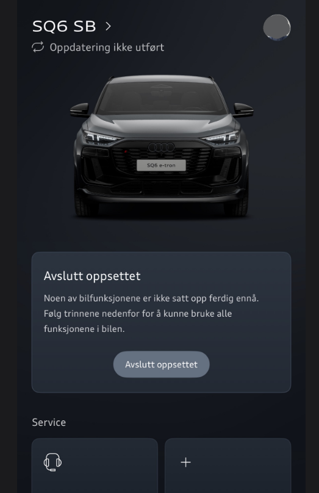

Velg så 'Konfigurer min Audi'

Du kommer hit, velg så myAudi-pålogging

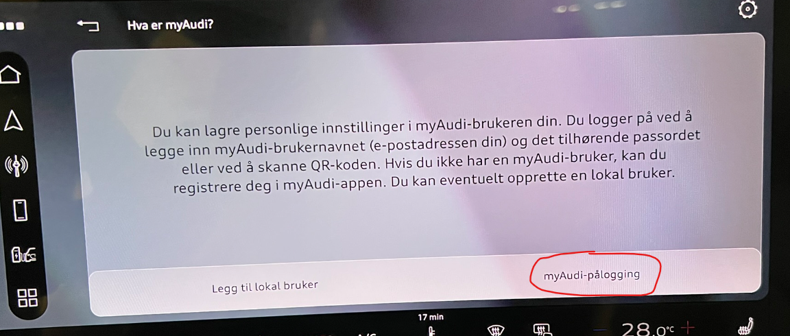

Du får opp en melding om at mobildata er deaktivert. Mobildata her betyr den dataforbindelsen som kommer med Audi Connect lisensen din. De 3 første årene er inkludert. Her må du velge 'Bruker Internett' eller får du ikke logget på.

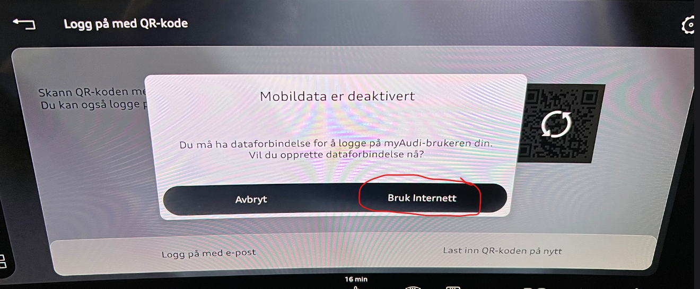

Det enkleste er å ta fram mobilkamare og scanne QR koden

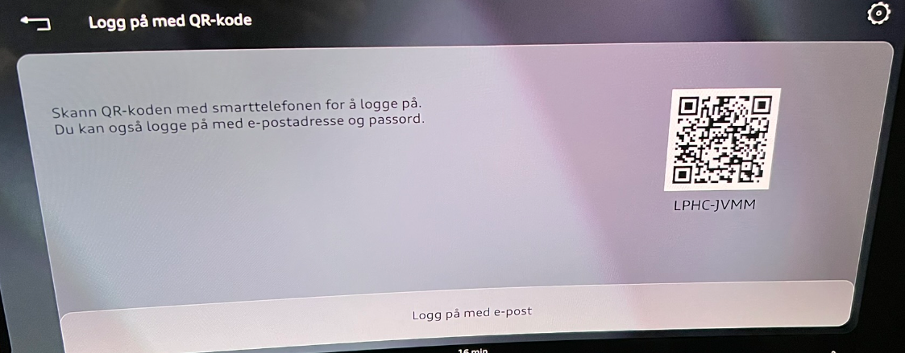

Da åpnet myAudi og du får opp et bekreftelsesbilde som har den bokstavkombinasjonen som stod under QR koden 

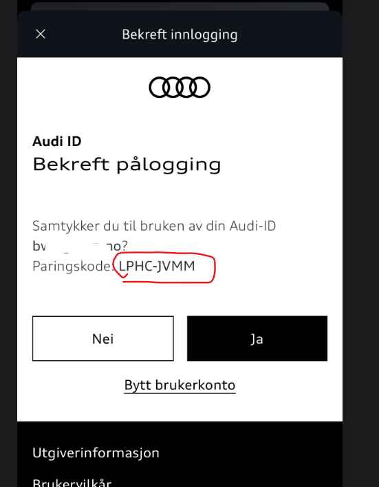

Så litt tolmodighet. Det er litt tid

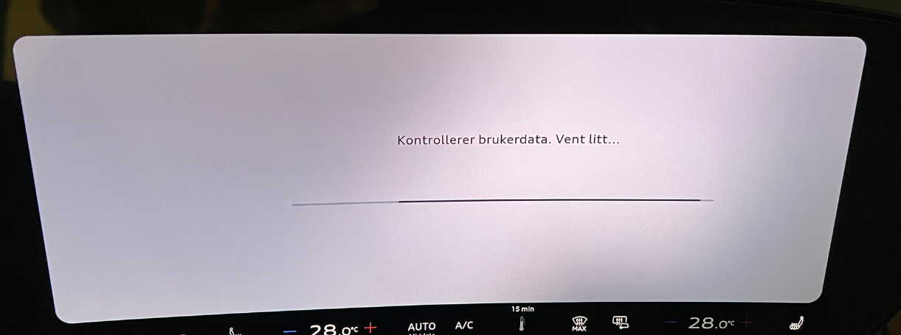

Mens du venter vil det sannsynligvis dukke opp en e-post som bekrefter at du nå er hovedbruker på den nye bilen.

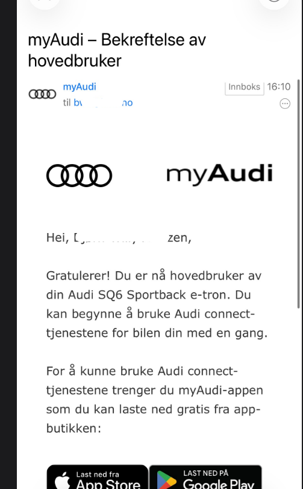

Et tillatelsebilde dukker opp, trykk på OK

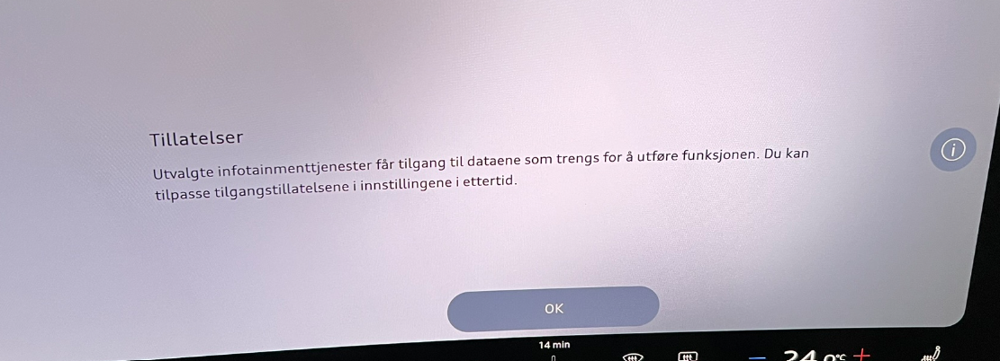

Du er rimelig nødt til å Aktivere online tjenester om du vil drive på med fjernstyring av bilen din

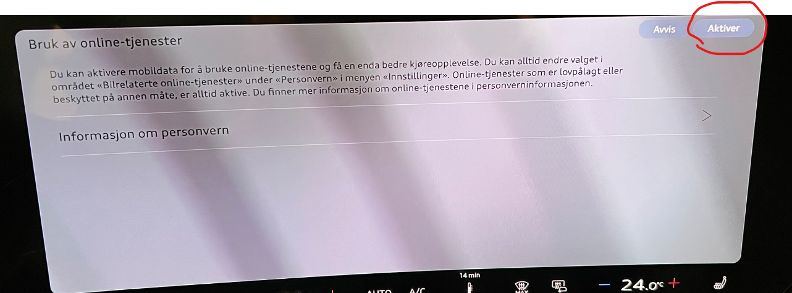

Videre kan du vurdere selv hvor mye du vil dele med Audi ...

Velg en av de 2 knappene øverst til høyre

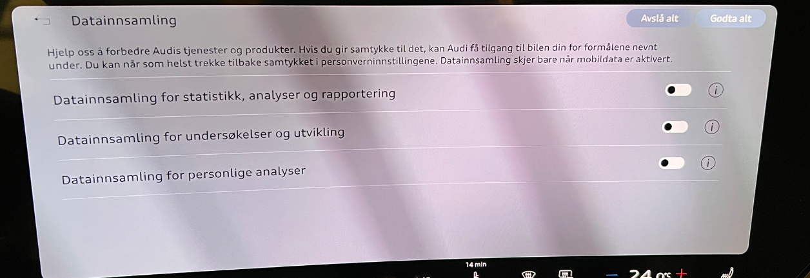

De fleste vil nok slippe å taste inn en PIN kode hver gang du skal bruke bilen ...

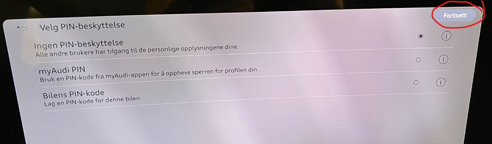

Flere valg du må sette ut i fra egne preferanser

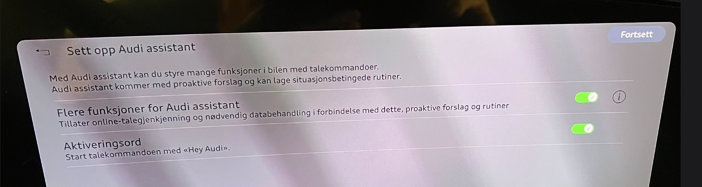

Der, du er ferdig med initiell bilkonfigurasjon

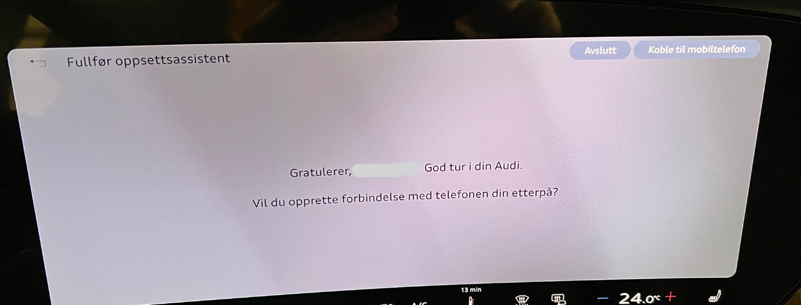

De fleste vil da fortsette med å sette opp forbindelse til mobiltelefon

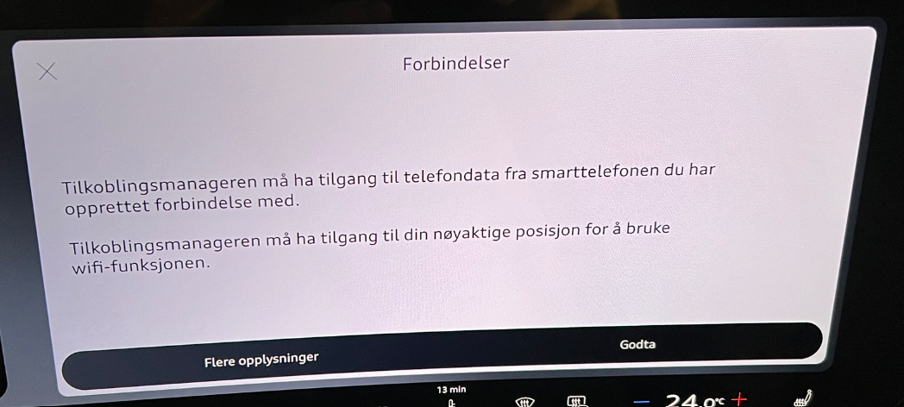

Her må du velge Godta for å fortsette

Bilen søker etter mobil på Bluetooth

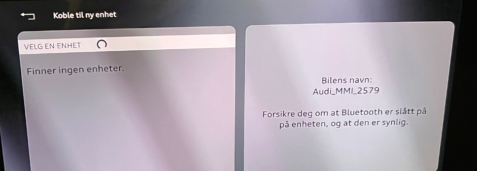

Forhåpentligvis dukker din mobil opp her

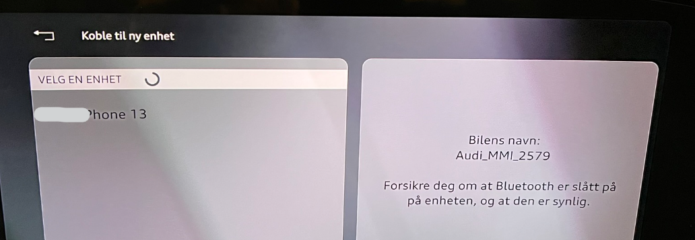

Du får en kode på mobilen som bør matche det som står på bildet i bilen

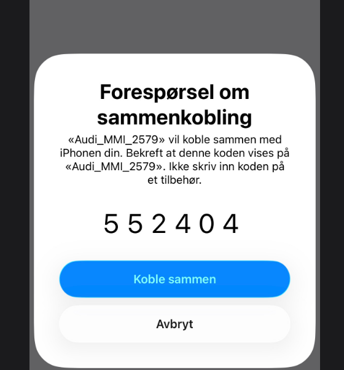

og mest sannsynlig er det vel at du også vil ha dine kontakter inn i mobildelen av MMI.

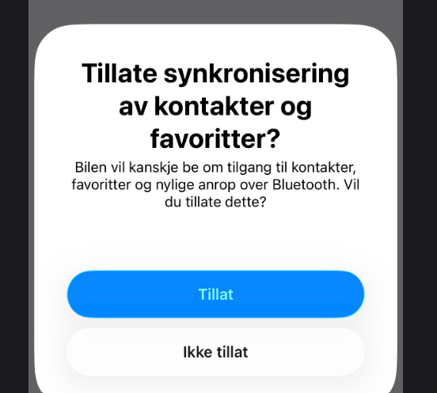

Mange legger også til CarPlay ( eller Android Auto og det er Android du bruker)

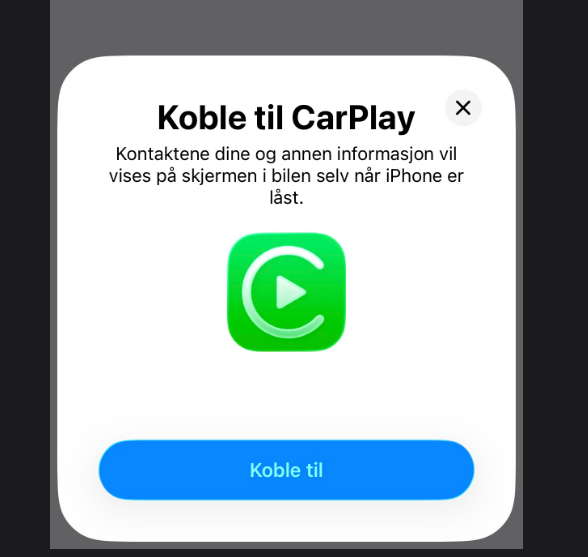

Da må du akseptere dette i bilens MMI

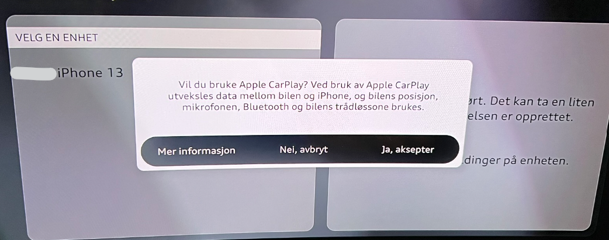

God Tur !

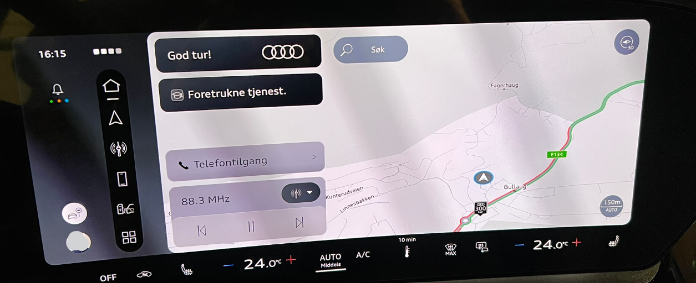

