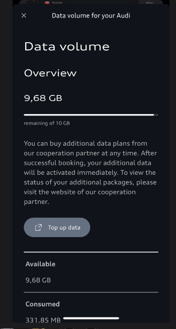

## Documentation in Progress

Below is an overview of all communication flows involving the vehicle:

Other useful reading : [Internet in car](../internet-in-the-car/)

## Audi Connect
This is a dedicated communication channel within the vehicle that utilizes an eSIM. A license is included for the first 3 years; thereafter, this functionality must be purchased via the Audi Shop.

Through this channel, the vehicle communicates with central servers, allowing the myAudi app to read or update data and/or the vehicle's status—for example, unlocking doors or activating climate control.

The Google Maps background used in the navigation system is also delivered via this communication channel.

## Audi Data Volume

This is a separate mobile data connection, also using an eSIM, but it functions as a distinct eSIM requiring its own separate agreement. This is included with the vehicle for the first 3 years and provides a data allowance of 10 GB per month.

This data package is used for the App Store and any applications installed from it.

You can also use this connection to create an in-car Wi-Fi hotspot that passengers can join; this shares the same 10 GB monthly data allowance.

## Home Wi-Fi Hotspot and Phone Wi-Fi Hotspot

It is also possible to connect the vehicle to an external Wi-Fi hotspot—such as your home network—or to share an internet connection from your mobile phone (or other similar devices capable of sharing internet access via Wi-Fi). When you choose to establish this connection (explained here), the Audi Data Volume connection is disconnected, and all the functions mentioned in that section will then use this connection instead.

## Phone/SMS/Music

This involves connecting your mobile phone as a Bluetooth device, enabling phone, SMS, and music playback features in the car via Bluetooth.

## Digital Key

This provides a digital key via your mobile phone, utilizing either Bluetooth or NFC. The method used depends on the type of mobile phone and whether or not the phone has run out of battery.

Most models support this via Bluetooth, allowing you to unlock the vehicle or the tailgate simply by having your phone in your pocket.

Alternatively, NFC requires you to hold your phone against the door handle to unlock the vehicle, and then place it in the charging station to be able to drive. This is designed to work even if the phone has run out of battery; however, this does entail a certain level of risk, so it is important to be aware of this.

## Car2Phone

..wip...