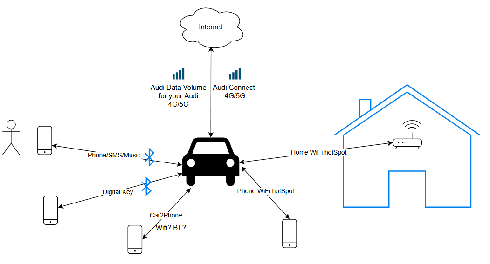
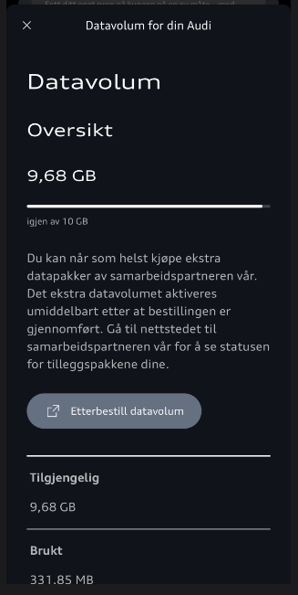

## dokumentasjonen er under arbeid

Her er et oversiktsbilde av alle kommunikajsons flyter som bilen faktisk har et forhold til

## Audi Connect
 Dette er en egen kommunikasjonskanal i bilen som bruker et eSIM kort og det følger med en lisens for de 3 første årene. Deretter må man kjøpe denne funksjone via Audi Shop

 Det er her bilen kommuniserer med sentrale servere slik at myAudi appen lese eller oppdatere dat og/eller tilstand i bilen. f.eks lås opp dør eller starte klimatisering.

 Googel Maps bakgrunn i Navigasjon kommer også via denne kommunikasjonskanalen

## Audi Data Volum

Dette er enda en mobil dataforbindelse med eSIM, men er et 'eget' eSIM kort og krever en egen avtale. Denne følger også med bilen de 3 første årene, og gir deg 10 GB data her måned.

Denne datapakken er det som bruker for AppStore og alle installerte Apps derfra.

Du kan også bruke denne forbindelsen til å starte opp en wifi sone i bilen som alle passasjerer kan logge seg på, men bruker samme 10 GB datakvote

## Home WiFi hotSpot og Phone WiFi hotSpot

Det er også mulig å kople opp bilen til en ekstern wifi hotSpot som kan vøre f.eks ditt hjemmenettverk eller del internett fra din mobiltelefon, eller andre tilsvarende enheter som har dele internett via Wifi. Når man har valgt å kople opp denne forbindelsen  (dette er forklar 'her'), så blir Audi Data Volum forbindelsen koplet ned og alle nevnte funksjoner i det avsnittet bruker da denne forbindelsen.

## Telefon/SMS/Musikk

Dette er din mobil koplet opp som en bluetooth enhet som gir bilen telefon, sms og musikkavspilling over bluetooth. 

## Digital Key

Dette gir den en digital nøkkel via di ntelefon, her kan det være enten bluetooth eller NFC. Dette er litt avhengig av type mobil og ev om mobilen er tom for strøm eller ikke.

