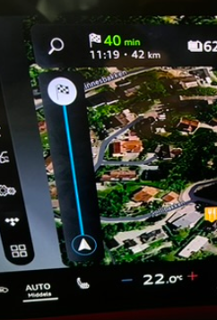
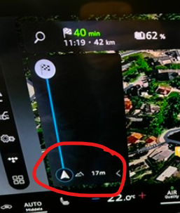
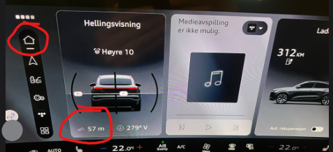
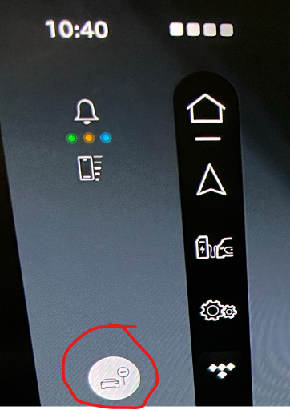
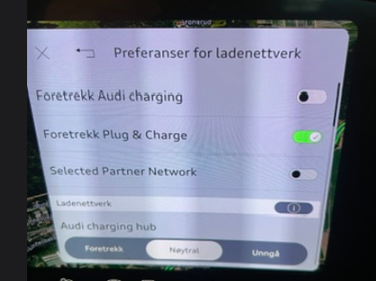
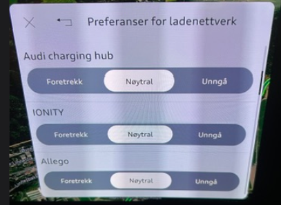
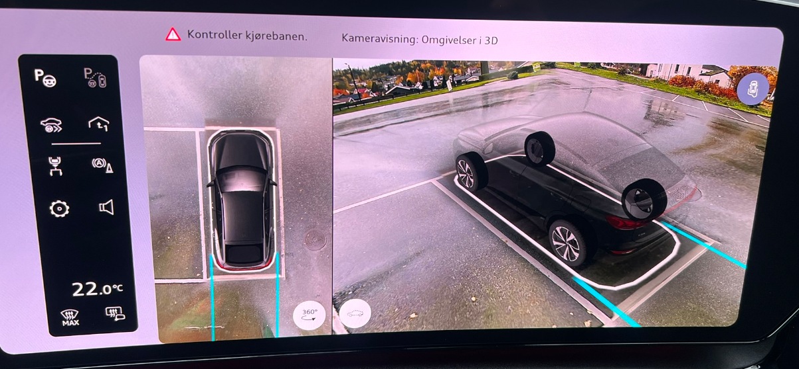
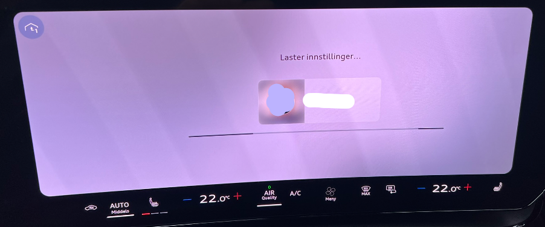
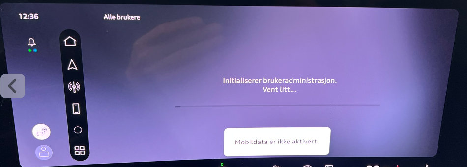

## 06.30.01/C

- Il s'agit provisoirement d'une mise à jour non-OTA
- v6.30.01/C est la version installée sur les Q6 (et probablement A6) livrés en octobre 2026

### Ce qui est corrigé ou amélioré par rapport à la version 06.11

- Non connu pour le moment

### Ce qui est corrigé ou amélioré par rapport à la version 03.11

La v03.11 correspond aux Audi Q6/SQ6 (et en pratique A6/S6) de l'année modèle 2025 (souvent appelée MY2025)

Il y a un certain nombre d'améliorations et de mises à jour. Voici celles qui méritent d'être mentionnées

- L'alerte demandant de tenir le volant s'affiche désormais dans l'affichage tête haute (HUD). [issue 107 dans la base de défauts](https://github.com/electrichasgoneaudi/q6-e-tron/issues/107)

- La fenêtre d'ouverture de la porte de garage fonctionne comme prévu [issue 67 dans la base de défauts](https://github.com/electrichasgoneaudi/q6-e-tron/issues/67)

- La voiture gère la recharge intelligente exactement comme elle le devrait. Elle indique que la recharge est en pause au lieu de signaler un défaut du système de recharge [issue 16 dans la base de défauts](https://github.com/electrichasgoneaudi/q6-e-tron/issues/16)

- L'altitude s'affiche désormais dans la vue de navigation. Mais uniquement lorsqu'un itinéraire est actif, et il faut ouvrir le panneau d'informations à gauche de la navigation  
  

On peut aussi utiliser l'affichage de la pente sur le 'Homescreen' si on choisit de l'y ajouter. Curieusement, les deux n'affichent pas la même valeur ...

- Audi drive select automatique. On peut désormais laisser la voiture choisir elle-même le mode drive select qu'elle juge adapté à votre style de conduite. Malheureusement, ce réglage doit être sélectionné manuellement à chaque trajet. On peut toutefois associer cette fonction au bouton étoile du volant.

- Un raccourci dédié pour désactiver l'alerte de dépassement de la limitation de vitesse. Cela libère le bouton étoile du volant pour d'autres fonctions

- Meilleur choix des opérateurs de recharge dans le planificateur de recharge embarqué. On peut désormais privilégier certains opérateurs ou technologies de recharge. Ce n'était pas entièrement possible sur le MY2025. Par exemple, avec un abonnement Audi Charging Pro offrant une recharge bon marché chez IONITY, on peut enfin faire en sorte que la voiture n'utilise que ceux-ci. Notez qu'il s'agit de préférences. La voiture choisira tout de même des alternatives pour s'assurer que vous rechargez suffisamment pour atteindre votre destination avec le SoC d'arrivée que vous avez défini.

 

- Le stationnement et l'assistant de stationnement sont nettement améliorés, mais cela dépend du modèle (matériel) et non du logiciel. On retrouve par exemple la vue 3D permettant de faire pivoter la perspective autour de la voiture à volonté, comme sur l'Audi e-tron à l'époque.

### Ce qui s'est dégradé
Certaines choses se sont effectivement dégradées.
- Le chargement du profil prend beaucoup de temps. On parle de 1 à 2 minutes avant que l'écran principal soit prêt

- Plusieurs cas de blocages, ou d'éléments qui mettent 4 à 5 minutes à se charger. Pas bon

- Et des plantages de l'écran principal, qui semblent déclenchés par un changement de morceau dans TIDAL. J'ai vérifié que Spotify ne déclenche pas un tel redémarrage de l'écran principal MMI. Notez que le son ne se coupe pas, et que même si le téléphone dans la vue principale doit se réinitialiser, l'icône de force du signal tout à gauche reste affichée en permanence ; cela ressemble donc à un simple bug de pilote d'affichage ou quelque chose de ce genre
<video src="/models/q6-e-tron/knowledgeexchange/updates/otapatch063001/IMG_9509.mp4" controls playsinline preload="metadata"></video>
<video src="/models/q6-e-tron/knowledgeexchange/updates/otapatch063001/IMG_9511.mp4" controls playsinline preload="metadata"></video>

Celle-ci montre que le Virtual Cockpit n'est pas affecté par la réinitialisation de l'écran principal.
<video src="/models/q6-e-tron/knowledgeexchange/updates/otapatch063001/IMG_9532.mp4" controls playsinline preload="metadata"></video>
- TIDAL perd parfois son état entre deux trajets. Même des pauses plus courtes peuvent faire perdre à l'application, par exemple, le morceau en cours, et tout doit être relancé depuis le début. Ce n'est tout simplement pas acceptable.
