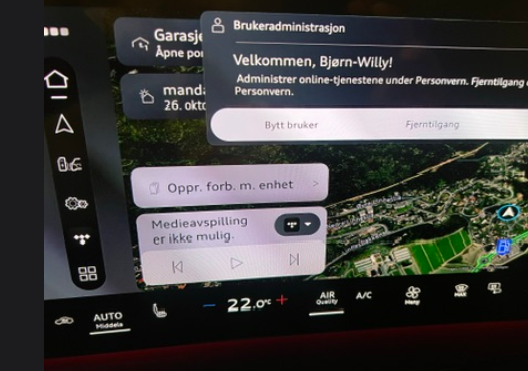

## 06.30.01/C

- This is currently not an OTA update
- v6.30.01/C is the installed version on Q6 (and probably A6) vehicles delivered in October 2026

### What was fixed or improved from version 06.11

- Unknown at the time of writing

### What was fixed or improved from version 03.11

v03.11 represents the Audi Q6/SQ6 (and in practice A6/S6) model year 2025 (often referred to as MY2025)

There are a number of improvements and updates. These are the ones worth mentioning:

- The hands-on-wheel warning is now shown in the Head-up Display (HUD). [Issue 107 in the issue tracker](https://github.com/electrichasgoneaudi/q6-e-tron/issues/107)

- The garage door opener popup works as it should. [Issue 67 in the issue tracker](https://github.com/electrichasgoneaudi/q6-e-tron/issues/67)

- The car handles smart charging exactly as it should. It shows that charging is paused instead of reporting a charging system fault. [Issue 16 in the issue tracker](https://github.com/electrichasgoneaudi/q6-e-tron/issues/16)

- Altitude is now shown in the navigation view, but only when you have an active navigation route and open the info panel on the left side of the navigation
  

You can also use the gradient view on the 'Homescreen' if you choose to add it there. Oddly enough, the two do not show the same value ...

- Automatic drive select. You can now let the car itself pick the drive select mode it thinks suits your driving style. Unfortunately this setting has to be selected manually on every trip. You can, however, assign this function to the star button on the steering wheel.

- A dedicated shortcut button turns off the speed limit warning. This frees up the star button on the steering wheel for other functions.

- Improved charging operator selection for the in-car charging planner. You can now prefer specific charging operators or technologies. That was not fully possible on MY2025. For example, if you have an Audi Charging Pro plan that gives you cheap charging at IONITY, you can finally get the car to use only those operators. Note that these are preferences. The car will still choose alternatives to make sure you can charge enough to reach your destination with the SoC you have set for arrival.

- Parking and the parking assistant are significantly improved, but this depends on the model (hardware), not the software. For example, the 3D view is back, letting you rotate the perspective around the car however you like, just like the Audi e-tron had back in the day.

### What has got worse
Some things have actually got worse.
- It takes a long time before the profile is loaded. We are talking about 1-2 minutes before the main screen is ready.

- There are several cases of hangs, or things taking 4-5 minutes to load. Not good.

- The main screen also crashes, seemingly triggered by changing tracks in TIDAL. I have tested that Spotify does not trigger such a restart of the MMI main screen. Note that the audio does not drop out, and although the phone in the main view has to reinitialize, the signal strength icon on the far left stays there the whole time. This looks like a pure display-driver bug or something similar.
<video src="/models/q6-e-tron/knowledgeexchange/updates/otapatch063001/IMG_9509.mp4" controls playsinline preload="metadata"></video>
<video src="/models/q6-e-tron/knowledgeexchange/updates/otapatch063001/IMG_9511.mp4" controls playsinline preload="metadata"></video>

This shows that the Virtual Cockpit is not affected when the main screen resets.
<video src="/models/q6-e-tron/knowledgeexchange/updates/otapatch063001/IMG_9532.mp4" controls playsinline preload="metadata"></video>
- TIDAL sometimes loses its state between trips. Even shorter breaks can end with the app losing, for example, the current track, and everything having to be started again from scratch.

Typically, the next day you see a message saying that media playback is unavailable and the playlist selection has to be started again from scratch.

- It is also quite frustrating that you have to confirm this almost every time you start a new trip. See the image above.

- The Wi-Fi and 3G/4G/LTE signal strength icons have been removed compared with MY2025. This is a shame, because they provide a very convenient indication of whether you are connected to an external access point, as well as the connection quality and the MMI uplink. The symbols shown below, which were present in v3.xx, are a significant loss.

There is plenty of space here.

