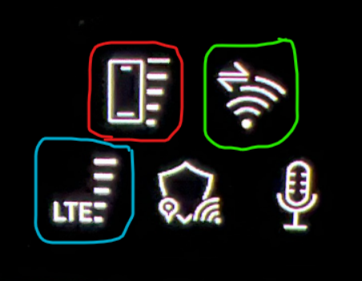
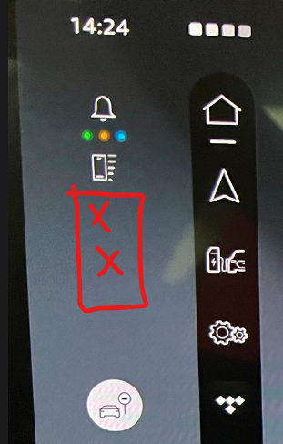

## 06.30.01/C

- Dette er foreløpig ikke OTA-oppdatering
- v6.30.01/C er installert versjon på Q6 (og sannsynligvis A6) levert ut oktober 2026

### Hva er rettet eller forbedret fra versjon 06.11

- Ikke kjent på nåværende tidspunkt

### Hva er rettet eller forbedret fra versjon 03.11

v03.11 representerer Audi Q6/SQ6 (og i praksis A6/S6) modell år 2025 (ofte omtalt som MY2025)

Det er en rekke forbedringer og oppdateringer. Her er det som er verdt å nevne

- Varsel om å holde i rattet vises nå i Head Up Display (HUD). [issue 107 i feildatabasen](https://github.com/electrichasgoneaudi/q6-e-tron/issues/107)

- Åpning av garasjeport popup fungerer som den skal [issue 67 i feildatabasen](https://github.com/electrichasgoneaudi/q6-e-tron/issues/67)

- Bilen håndterer smartlading akkurat som det skal gjøres. Viser at lading er pauset istedet for feil med ladesystemet [issue 16 i feildatabasen](https://github.com/electrichasgoneaudi/q6-e-tron/issues/16)

- Høyde over havet vises nå i navigasjonsbildet. Men kun når du har en aktiv navigasjonsrute og man må åpne infobildet til venstre i navigasjonen  
  

Man kan også bruke hellingsvisning i 'Homescreen' om du velger å legge inn hellingsvisning der. Pussig nok viser ikke disse samme verdi ...

- Automatisk driveselect. Man kan nå velge at bilen selv bruker den drive select modus som den mener passer til din kjørestil. Dessverre må denne innstillingen velges manuelt på alle kjøreturer. Man kan dog velge å kople denne funksjonen til stjerneknappen på rattet.

- Egen hurtigknapp for å slå av fartsgrense overskridelses varselet. Det vil frigjøre sstjerneknappen på rattet til andre funksjoner

- Forbedret valg av ladeoperatør for ladeplanleggeren i bilen. Nå kan man preferere bestemte ladeoperatører eller teknologier. Det var ikke fullt ut mulig på MY2025. f.eks om man har en Audi Charging Pro avtale som gir billig lading på IONITY, så man kan endelig få bilen til å bare bruke disse. Legg merke til at det er foretrukkede verdier. Bilen vil jo velge alternativer for å sikre at du får ladet bilen nok til din destinasjon og de innstillinger du var valgt for SoC verdier på destinasjonsmålet ditt.

 

- Parkering og parkeringsassistent er betydelig forbedret, men er jo modellbetinget (hardware), og ikke programvarebetinget. Man har f.eks fått tilbake 3D bilde som man kan vri perspektivet på bilen til det man ønsker, slik som Audi e-tron hadde i sin tid.

### Hva er blitt dårligere
Det er faktisk ting som er blitt verre.

- Opplever betydelig tid før profil er lastet inn. Vi snakker om 1-2 minutter før hovedskjerm er klar

- Flere tilfeller av heng eller ting som tar 4-5 minutter å laste inn. Ikkje bra

-  Og krash i hovedskjerm, ser ut til å trigges av låtbytte i TIDAL. Har testet at Spotify ikke trigger en slik restart av MMI hovedskjerm. Legg merke til at lyden ikke blir borte og at selv om mobilen i hovedbildet må reinitialiseres, så er ikonet for signalstyrke helt til venstre der hele tiden, så dette virker å være en ren display driver type bug eller noe slikt

<video src="/models/q6-e-tron/knowledgeexchange/updates/otapatch063001/IMG_9509.mp4" controls playsinline preload="metadata"></video>

<video src="/models/q6-e-tron/knowledgeexchange/updates/otapatch063001/IMG_9511.mp4" controls playsinline preload="metadata"></video>

Denne viser at Virtual Cockpit blir ikke påvirket av at hovedskjerm resetter seg.
<video src="/models/q6-e-tron/knowledgeexchange/updates/otapatch063001/IMG_9532.mp4" controls playsinline preload="metadata"></video>
- TIDAL mister av og til sin tilstand mellom hver kjøretur. Også kortere pauser kan ende opp med at appen mister f.eks gjeldende låt og alt må startes helt på nytt.

-  Signalstyrkeikon for WiFi og 3G/4G/LTE er fjernet i forhold til MY2025. Det er veldig synd, for det er en veldig lettvindt indikator for om man er koplet til ekstern aksesspunkt eller ikke, samt kvaliteten på dette og uplink for MMI.
Symbolene som er vist under og var på plass i v3.xx er et stort tap å ikke ha lengre

Er plass i massevis her

